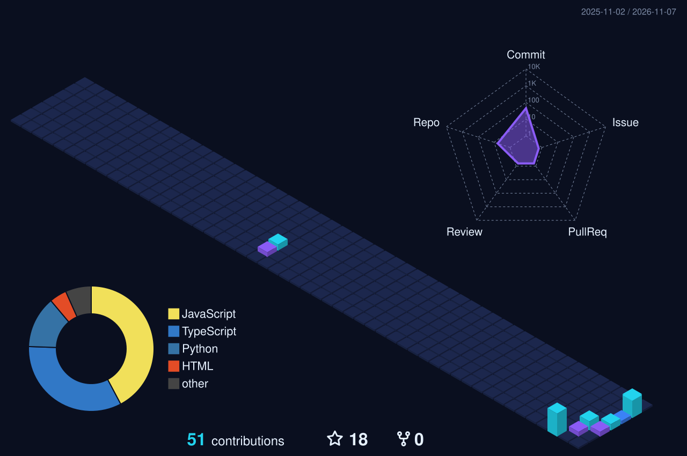

 

  

  

  

  

  

  

  

  

  

 

 

  

  

<picture>
  <source media="(prefers-reduced-motion: reduce)" srcset="https://raw.githubusercontent.com/juliangonzalez-tech/juliangonzalez-tech/main/assets/music-still.png" />
  
</picture>

 

Built with open-source tools. <a href="./THIRD_PARTY_NOTICES.md">Credits and licenses</a>

