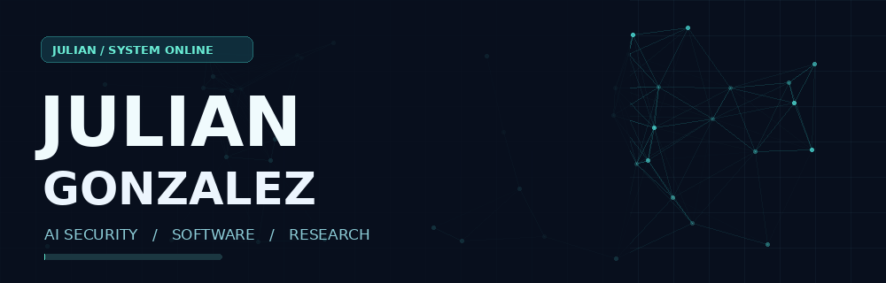
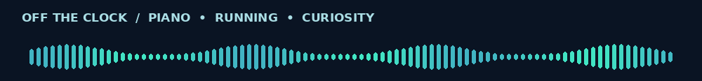

<picture>
  <source media="(prefers-reduced-motion: reduce)" srcset="https://raw.githubusercontent.com/juliangonzalez-tech/juliangonzalez-tech/main/assets/hero-still.png" />
  
</picture>

### Building useful software. Testing what AI systems miss.

I'm Julian, a high school student developer and independent researcher exploring **AI security, model reliability, and human-centered software**. I like building things that people actually use, then asking how those systems behave when conditions change.

[**Explore Signal Lab ↗**](https://juliangonzalez-tech.github.io/signal-lab/) · [**My repositories ↗**](https://github.com/juliangonzalez-tech?tab=repositories)

---

### `01 /` What I'm building

<table>
<tr>
<td width="50%" valign="top">
<h3>📚 NotCooked</h3>
A student-first planner that turns scattered coursework into a clear next step: <b>Canvas and Google Classroom imports</b>, next-task recommendations, and focus sessions. Built with <b>React Native, Expo, and Firebase</b> and shaped by feedback from 25+ beta-testing students.
  <b>Status:</b> private beta · source is private <a href="https://github.com/juliangonzalez-tech/notcooked">Screenshots and write-up ↗</a>
</td>
<td width="50%" valign="top">
<h3>🔬 AI-security research</h3>
How much do evaluation design and attacker novelty change measured prompt-injection detector robustness? I compare random and chronological splits and leave-one-attacker-out tests on adaptive human attacks (LLMail-Inject), using word- and character-level <b>TF-IDF</b> and <b>DistilBERT</b>.
  <b>Status:</b> independent study · results validated · paper not yet published
</td>
</tr>
<tr>
<td valign="top">
<h3>🛡️ SignalQuarry</h3>
An explainable security log analyzer: four rule-based detections, interactive dashboards, and alerts that show the exact log rows behind them. <b>Python, Streamlit, pandas.</b> Scored against a 45-case synthetic evaluation set, with its blind spots documented.
  <a href="https://github.com/juliangonzalez-tech/signalquarry">Open the repository ↗</a>
</td>
<td valign="top">
<h3>🔐 CipherScore</h3>
A browser-based password checker and generator: CSPRNG generation, EFF passphrases, zxcvbn-ts estimates, and a k-anonymity breach check that sends only a 5-character hash prefix. <b>Next.js, TypeScript, Tailwind CSS.</b>
  <a href="https://github.com/juliangonzalez-tech/cipherscore">Open the repository ↗</a>
</td>
</tr>
<tr>
<td colspan="2" valign="top">
<h3>🎮 Signal Lab</h3>
An experimental, interactive mini-site where visitors repair a simulated signal network. A playful companion to the research theme.
  <a href="https://juliangonzalez-tech.github.io/signal-lab/">Open the interactive lab ↗</a>
</td>
</tr>
</table>

### `02 /` The toolkit

**Languages:** Python · TypeScript · JavaScript  
**Build:** React Native · Expo · Firebase · Next.js · Streamlit · GitHub Actions  
**Explore:** Machine learning · NLP · Evaluation methodology · Defensive security

### `03 /` Research mentality

> A detector looking strong on familiar examples doesn't tell the whole story. I care about how systems behave on the examples they haven't learned to expect.

In my evaluations, random splits leaked exact copies of training attacks into the test set far more often than chronological splits (about 62.8% vs 4.3%), while previously unseen attackers varied much more than time alone. I also write down what the results *don't* show: they don't say every future attack is harder, or that every unseen attacker causes a large drop.

**Current interests:** prompt injection • distribution shift • trustworthy AI • practical student tools

### `04 /` Beyond code

<picture>
  <source media="(prefers-reduced-motion: reduce)" srcset="https://raw.githubusercontent.com/juliangonzalez-tech/juliangonzalez-tech/main/assets/music-still.png" />
  
</picture>

I play piano, run track, and enjoy the overlap between technical precision and creative expression. Music gives me a different kind of problem to solve.

---

Thoughtfully built, not auto-generated statistics. · <a href="https://juliangonzalez-tech.github.io/signal-lab/">Enter Signal Lab</a>

