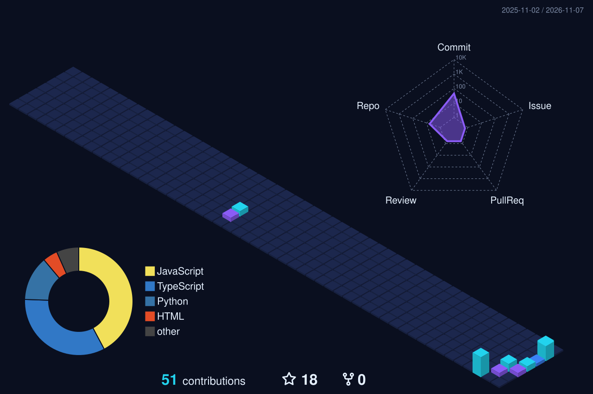

# Restoring the 3D contribution view

The workflow still generates the 3D contribution graph every day (settings in `.github/profile-3d/settings.json`, output `profile-3d-night.svg` on the `generated` branch). The README does not show it. To bring it back, add this to `README.md` where you want it:

```html
<p></p>
```

The previous README, including its section headings and the other widgets, is preserved in git: `git show backup-before-graphite-arcade:README.md`.
