# Restoring the Pac-Man

The Pac-Man was replaced by the night city. Nothing was deleted:

- The workflow still generates it every run (`arcade` job in `.github/workflows/profile-graphics.yml`, using `abozanona/pacman-contribution-graph`, pinned to an exact commit and run unmodified; that project has no license, so none of its code is copied here).
- Its newest output stays on the `generated` branch as `pacman-contribution-graph-dark.svg`.
- A static copy of the last version that was live is in `archive/pacman/pacman-contribution-graph-dark.svg`.

To bring it back, add this to `README.md` where you want it (for example after the city):

```html
<p><br /><sub>Pac-Man eats my public contributions. Updated daily.</sub></p>
```

The previous README, with the six-cell stack panel, is in `archive/graphite-arcade/`. It is also in git: `git show backup-before-graphite-arcade:README.md` and the tag `backup-before-city` that is created before the city goes live.
