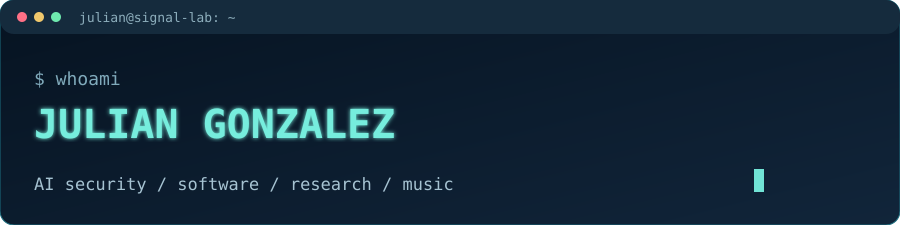

### AI security · Software engineering · Research

**I build useful products and study how intelligent systems behave when the unexpected happens.**

[**▶ ENTER THE INTERACTIVE SIGNAL LAB**](https://YOUR-USERNAME.github.io/YOUR-REPO/)

---

### Selected work

- **Independent AI security research** — Evaluating prompt-injection detectors under distribution shift, including unseen teams and future examples.
- **NotCooked** — A student-first schoolwork planning application, built with React Native and Firebase.
- **Security engineering projects** — Practical tools and experiments in defensive security.

### Beyond the terminal

Piano 🎹 · Running 🏃 · Learning by building ⚡

### Contribution animation

<!-- Once you configure the optional snake workflow, uncomment and update this image URL:

-->

> The interactive experiment is hosted separately on GitHub Pages because GitHub READMEs do not execute custom JavaScript.
